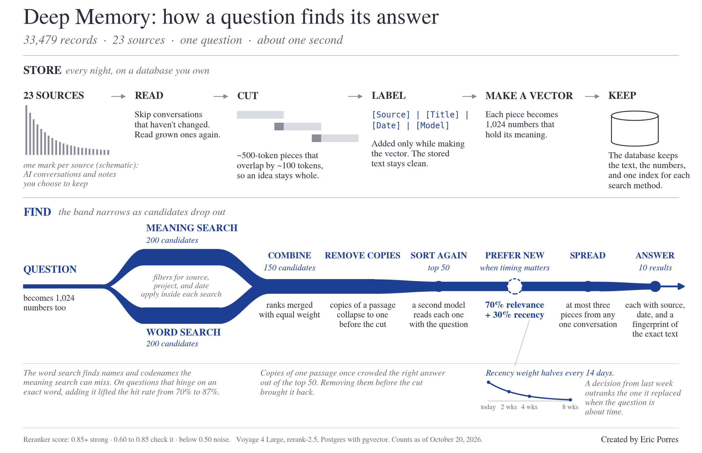

# Second-Brain Blueprint

The blueprint from ["How I Built My Second Brain"](https://promptedbyeric.substack.com/p/how-i-built-my-second-brain) (*Beyond Reason*, October 20, 2026), packaged as a skill that audits your knowledge base against it.

Point it at your notes. It comes back with one finding per step, each tied to a file you can open, and the first three fixes in order.

## What this is

The article gives away the architecture of a personal AI memory system: what to ingest, how to write the answer key, where to store it, how to search it, what every result has to carry, what the agent's operating manual says, and how to benchmark the result. The code stays private. This repo is the part of the blueprint that runs on anyone's system.

It is an audit, not a build. The first reader to run the blueprint didn't build anything. He took the seven steps as questions, ran six weeks of his own files through them (a folder of Markdown with frontmatter, synced through SharePoint), and found the article's "agent read half a thread" problem in his own data in a different shape: supersession recorded in prose where his validator couldn't see it. His report added two checks the article doesn't have, which is why the skill is a separate thing from the article: supersession has a granularity question (prose, file, or decision), and tag drift has a mirror failure, collapse, that a validator watching for singletons never sees.

Steps 3, 4, and 7 name the components I chose (Postgres with pgvector, Voyage embeddings, a cross-encoder reranker, LongMemEval). A skill can't run those on your stack, and shipping them would be the build. Steps 1, 2, 5, and 6 are judgment, and judgment runs on Markdown in a folder as well as it runs on a vector database.



## Install

The skill is one Markdown file, `SKILL.md`, in the [Agent Skills](https://agentskills.io) format. Any Skills-aware client can load it.

**Claude Code**

```bash
mkdir -p ~/.claude/skills/second-brain-audit
curl -fsSL https://raw.githubusercontent.com/ericporres/second-brain-blueprint/main/SKILL.md \
  -o ~/.claude/skills/second-brain-audit/SKILL.md
```

Or with the [skills CLI](https://skills.sh), which installs into whichever agents you use:

```bash
npx skills add ericporres/second-brain-blueprint
```

**Claude (web or desktop)**: upload `SKILL.md` as a skill in Settings.

**Codex, Cursor, or anything else that reads `SKILL.md`**: copy the file into that client's skills directory.

## Use

Give it a path, an export, or a few representative files:

> Audit my knowledge base at `~/notes` against the blueprint.

> Here are twelve files from my decision log and the skill that writes them. Where does this break?

> `/second-brain-audit`

No files means no evidence. The skill will mark every finding Unverified and say so, because an opinion without a file to open is the thing the audit exists to replace.

## What you get

```
# Second-brain audit: <your system>, <date>

Inventory: files, projects, date range, decisions, formats, tags, relations,
read side, answer key.

## 1. What counts as memory      Status, Evidence, Finding
## 2. Answer key
## 3. Where it lives
## 4. Search two ways
## 5. Pointers with receipts
## 6. Operating manual
## 7. Public benchmark

## Fix first                      three changes, in order
## Not checked                    what the audit couldn't see
```

Every finding quotes the files. The report runs about a page plus evidence.

## The seven steps

1. **Decide what counts as memory.** Records of thinking, not the files the thinking produced. Employer data stays in employer systems.
2. **Write the answer key before you tune anything.** Real questions, the exact passage that answers each, frozen. No retrieval change ships without a before-and-after.
3. **Store it where you own it.** Passages, embeddings, a database you control. Markdown in a folder passes.
4. **Search two ways, then let a reranker read.** Meaning plus keyword, fused, duplicates collapsed before the cut, recency blended in for time questions.
5. **Return pointers with receipts.** Source, speaker, date, fingerprint. The agent reopens the passage. A score ranks; it doesn't vouch.
6. **Write the operating manual.** A hit is a pointer, never the answer. Before calling a question open, ask it again in neutral words and chase the thread forward in time. An empty result means nothing matched, never that the search broke.
7. **Then test it on a public benchmark.** LongMemEval_s, MemPalace's protocol, the held-out 450. Retrieval recall is not answer accuracy.

The article has the reasoning behind each one and the receipts.

## Field reports

The skill got better from the first report before it shipped. If you run it, open an issue with your inventory line and the finding that surprised you. What breaks in your data is what the next version checks for.

## Related

- [deep-memory](https://github.com/ericporres/deep-memory): the March 2026 keyword-search version, still open source. The semantic build this blueprint describes is a separate, private system.
- [voice-as-a-skill](https://github.com/ericporres/voice-as-a-skill): the same idea applied to writing voice.

## License

MIT. Built by [Eric Porres](https://github.com/ericporres).
